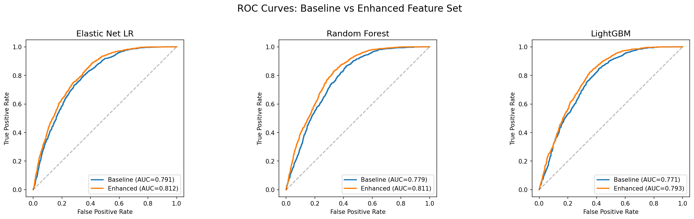
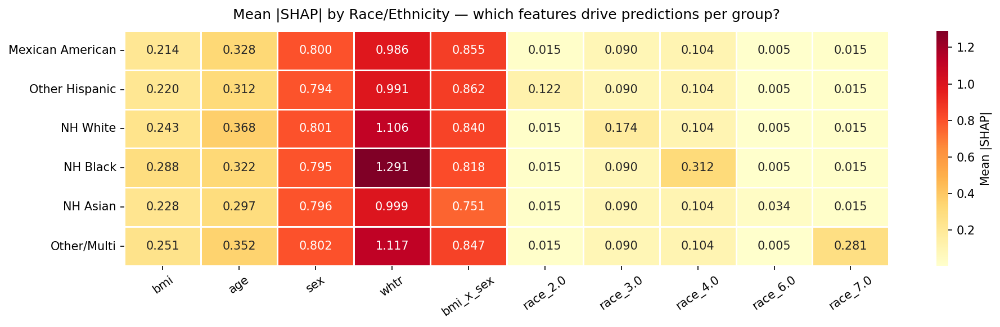

# Beyond BMI: Predicting Metabolic Syndrome

Does a small set of engineered features predict metabolic syndrome (MetS) better than BMI alone? Using NHANES 2017–March 2020 data (3,568 non-pregnant adults), we compare a screening-style **baseline** (BMI, age, sex) against an **enhanced** feature set that adds waist-to-height ratio (WHtR), a BMI×sex interaction, and race/ethnicity indicators, across three classifiers.

Full writeup: [`writeup.pdf`](writeup.pdf)

## Method

- **Data:** Six NHANES tables (demographics, body measures, blood pressure, HDL, triglycerides, fasting glucose) merged by respondent ID. ~36% of the sample meets MetS criteria.
- **No label leakage:** Waist circumference is part of the MetS definition, so it isn't used directly; WHtR is used instead.
- **Models:** Elastic net logistic regression, random forest, and LightGBM, each trained on both feature sets.
- **Evaluation:** Stratified 5-fold cross-validation; AUROC as the primary metric plus precision, recall, specificity, and F1. SHAP for feature attribution, and per-group performance by race/ethnicity.

## Results

| Features | Model | AUROC | Recall | F1 |
|---|---|---|---|---|
| Baseline | Elastic Net LR | 0.791 ± 0.008 | 0.463 | 0.538 |
| Baseline | Random Forest | 0.779 ± 0.008 | 0.586 | 0.591 |
| Baseline | LightGBM | 0.771 ± 0.006 | 0.562 | 0.573 |
| Enhanced | Elastic Net LR | **0.812 ± 0.006** | 0.535 | 0.593 |
| Enhanced | Random Forest | 0.811 ± 0.009 | 0.629 | 0.625 |
| Enhanced | LightGBM | 0.793 ± 0.009 | 0.607 | 0.610 |

The enhanced features improve AUROC for every classifier (p < 0.001). SHAP shows WHtR and the BMI×sex interaction drive most of the gain.



**Subgroup gap:** Performance is similar across most race/ethnicity groups (AUROC 0.79–0.81), but the model misses **72.6%** of MetS-positive Non-Hispanic Asian participants at the default threshold, compared with 38–49% for other groups.



## Repo layout

```
notebooks/
  01_nhanes_data_cleaning.ipynb             Merge NHANES tables, filter, define MetS
  02_feature_engineering_models_eval.ipynb  Features, models, CV, SHAP, subgroup analysis
data/
  raw/       NHANES 2017–2020 .xpt files (public, from the CDC)
  cleaned/   Analytic dataset
results/     Metrics CSVs and figures
writeup.pdf
```

The notebooks were written for Google Colab and read from Google Drive paths; point `path` at `data/` to run locally. Requires pandas, numpy, scikit-learn, lightgbm, shap, scipy, matplotlib, and seaborn.

## Authors

Ria Raheja, Sachi Patel, Diya Nair (Barnard College)
